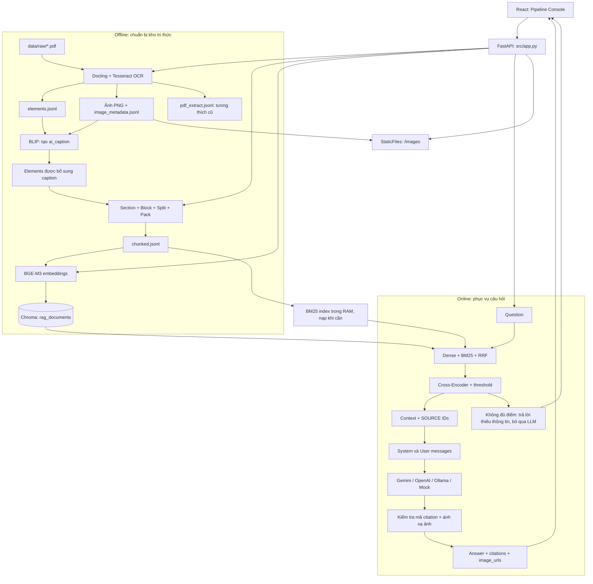
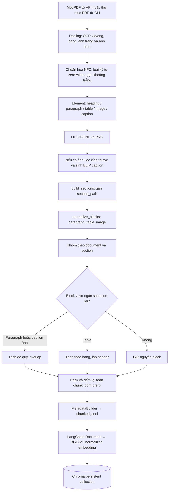
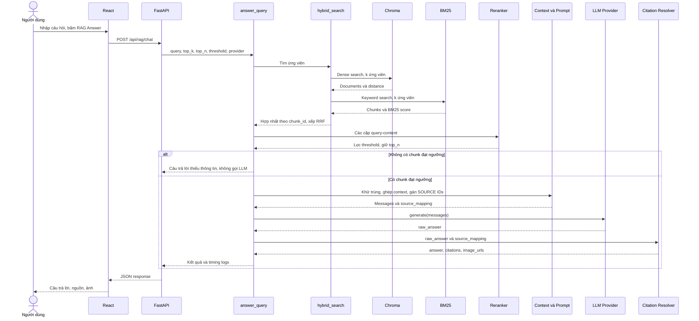

# RagPipeline — Giới thiệu và thuyết trình kỹ thuật hệ thống RAG

> Ngày phân tích: **15/10/2026**. Phạm vi: source trong working tree hiện tại, không chỉ phiên bản đã commit. Tài liệu được xây dựng bằng đọc tĩnh mã nguồn, cấu hình và một số artifact JSONL/CSV/JSON để đối chiếu. Không chạy pipeline, tải model, gọi LLM, chạy benchmark, mở database bằng Chroma client hoặc thay đổi dữ liệu. Giá trị API key không được đưa vào tài liệu.

## 1. Giới thiệu project

**RagPipeline là ứng dụng hỏi đáp trên PDF tiếng Việt, kết hợp truy xuất tài liệu và mô hình ngôn ngữ để trả lời kèm nguồn.** Repository còn dùng tên `vi-coze`, giao diện dùng tên **RAG Lab / Pipeline Console**. Dữ liệu hiện có thiên về pháp luật lao động; thuật toán chính là RAG tổng quát, chưa có bộ suy luận pháp lý chuyên biệt hay quản lý hiệu lực văn bản.

**RAG — Retrieval-Augmented Generation** nghĩa là *sinh câu trả lời có bổ sung thông tin truy xuất*: hệ thống tìm các đoạn tài liệu liên quan trước, rồi đưa chúng vào ngữ cảnh của **LLM — Large Language Model**, tức mô hình ngôn ngữ lớn. Không thấy bước huấn luyện hoặc fine-tuning mô hình trong project.

Bài toán hệ thống hướng đến:

- Tìm thông tin trong nhiều trang PDF tiếng Việt, gồm chữ, bảng và ảnh.
- Hạn chế mất quan hệ giữa tiêu đề, đoạn văn, hàng/cột của bảng khi chia tài liệu.
- Kết hợp tìm theo ý nghĩa với tìm theo từ khóa, hữu ích cho tên riêng và thuật ngữ.
- Trả câu trả lời tiếng Việt có mã nguồn `[SOURCE_X]`, tên file, trang, mục và ảnh liên quan.
- Cung cấp giao diện để quan sát các bước nạp tài liệu, chia đoạn, lập chỉ mục và truy xuất.

Hai vòng đời được tách biệt: **Offline** chuẩn bị kho tri thức; **Online** phục vụ từng câu hỏi. “Offline” ở đây là xử lý trước lúc hỏi, không có nghĩa mọi lần chạy đều không cần mạng: lần đầu tải Docling/BLIP/BGE có thể cần model; nhà cung cấp LLM từ xa cần kết nối.

**Bằng chứng:** [`src/app.py`](../src/app.py), [`src/rag/rag_pipeline.py`](../src/rag/rag_pipeline.py) — `answer_query`, [`frontend/src/main.jsx`](../frontend/src/main.jsx) — `App`, [`src/__init__.py`](../src/__init__.py). Docstring nhắc “Prompt Guard” trong `src/__init__.py` không phải bằng chứng có một module bảo vệ riêng.

### 1.1. Công nghệ thực sự được gọi

| Tầng | Công nghệ trong code | Vai trò và giới hạn xác nhận |
|---|---|---|
| Backend | Python, FastAPI, Pydantic | REST API; các handler chính là hàm `def` đồng bộ. Không có hệ thống job nền riêng |
| Đọc PDF | Docling, Tesseract CLI | OCR `vie`, `eng`; nhận diện bảng; xuất ảnh và phần tử cấu trúc |
| Mô tả ảnh | Transformers, Pillow, BLIP base | Đổi ảnh thành mô tả văn bản; chưa đưa pixel ảnh vào LLM khi hỏi đáp |
| Chunking | Module tùy chỉnh, `RecursiveCharacterTextSplitter`, tiktoken | Bám cấu trúc document/section/block; đếm bằng `cl100k_base` |
| Embedding | `HuggingFaceEmbeddings`, Sentence Transformers, `BAAI/bge-m3` | Mã hóa văn bản thành vector, có chuẩn hóa độ dài vector |
| Vector store | ChromaDB, `langchain-chroma` | Lưu cục bộ tại `data/vectorstore/chroma`, collection `rag_documents` |
| Sparse retrieval | BM25 tự viết bằng Python | Không import thư viện `rank_bm25`; không dùng sparse output của BGE-M3 |
| Hợp nhất | RRF tự viết | Cộng nghịch đảo thứ hạng của hai danh sách |
| Reranking | `CrossEncoder`, fallback Transformers | Model mặc định `BAAI/bge-reranker-v2-m3`, chạy CPU |
| Sinh câu trả lời | Gemini SDK; OpenAI/Ollama qua HTTP; Mock | Có abstraction provider; độ sẵn sàng dịch vụ chưa được kiểm tra trong lần phân tích này |
| Frontend | React 18, Vite 6, Lucide, CSS | Một trang console, gọi API bằng `fetch` |
| Đánh giá | Sentence Transformers, scikit-learn, pandas/openpyxl, Ragas, LangChain Google GenAI | Nhiều bộ chấm riêng với định nghĩa metric khác nhau |

Phiên bản React/Vite là khai báo trong [`frontend/package.json`](../frontend/package.json); không phải cam kết về bản đang chạy. Python requirements chủ yếu dùng `>=`, không khóa một môi trường có thể tái tạo hoàn toàn. Không suy ra kích thước vector, metric khoảng cách hay năng lực tối đa chỉ từ tên model/thư viện.

## 2. Kiến trúc tổng thể



Đây là một backend điều phối các module Python và file cục bộ; không có microservice OCR, embedding hay retrieval độc lập. Chroma lưu bền trên đĩa; BM25 được dựng từ JSONL và cache trong tiến trình. Hai chỉ mục phải cùng một phiên bản corpus — *tập tài liệu* — nhưng code chưa quản lý phiên bản chung.

Sơ đồ thể hiện kết nối chức năng. Trong `hybrid_search`, Dense chạy trước BM25, chưa chạy song song. Các API offline là ba thao tác riêng; frontend gọi tuần tự, không có transaction bao trùm cả chuỗi.

## 3. Luồng Offline: PDF → Parsing/OCR → Chunking → Embedding → ChromaDB



### 3.1. Đọc PDF và OCR

[`src/data/pdf_loader.py`](../src/data/pdf_loader.py), các hàm `create_converter` (dòng 43), `extract_elements_from_docling` (64), `convert_pdfs` (183):

1. Nhận đường dẫn một file hoặc thư mục. Với thư mục, lấy các file `*.pdf` trực tiếp, không duyệt đệ quy.
2. Cấu hình Docling: `do_ocr=True`; `TesseractCliOcrOptions(lang=["vie", "eng"], force_full_page_ocr=False)`; `do_table_structure=True`; bật sinh ảnh hình và ảnh trang. Đây là OCR có cấu hình thật, không phải chỉ một tùy chọn trong tài liệu.
3. Duyệt `doc.iterate_items()`, phân loại dựa trên tên class; lấy trang từ provenance đầu tiên, mặc định 1. Heading lấy `level` nếu có; table xuất Markdown; ảnh gọi `get_image(doc)` để lưu PNG.
4. `clean_text` chuẩn hóa Unicode NFC, loại zero-width/BOM, gộp space/tab, giảm nhiều dòng trống. Không có bước sửa chính tả OCR hay nhận diện hiệu lực pháp luật.
5. Ghi đè các file đầu ra: `elements.jsonl`, `image_metadata.jsonl`, `pdf_extract.jsonl`; ảnh lưu dưới `data/images/<pdf_stem>/fig_XXX.png`.

**Đầu vào:** PDF và khả năng hoạt động của Docling/Tesseract cùng bộ ngôn ngữ. **Đầu ra chính:** mỗi dòng JSONL là một element. **JSONL — JSON Lines** là định dạng mỗi dòng chứa một đối tượng JSON độc lập, thuận tiện kiểm tra và truyền giữa các bước.

Ví dụ schema minh họa, không phải trích dữ liệu thực:

```json
{
  "document_id": "tai_lieu",
  "element_id": "e_0001",
  "type": "paragraph",
  "text": "Nội dung được trích xuất",
  "page": 1,
  "level": null,
  "table_data": null
}
```

Ảnh thêm `image_id`, `image_path`, kích thước, `caption`, `ai_caption`. Table có `table_data.markdown`. `pdf_extract.jsonl` gom text theo trang và có `metadata.source/page/title/file_type`; vì vậy đếm dòng của file này là đếm **bản ghi trang**, không phải số PDF.

**Giới hạn:** phân loại theo tên class phụ thuộc biểu diễn mà Docling trả về; không thể từ đó khẳng định nhận diện đúng mọi heading/caption. `force_full_page_ocr=False` không bảo đảm mọi trang được OCR toàn bộ. `convert_pdfs` bắt lỗi từng PDF rồi tiếp tục ghi output; API có thể trả `success` dù parsing một file thất bại và output rỗng. Các lần nạp một PDF qua UI thay thế JSONL chung, không tự nối thêm tài liệu vào kho.

### 3.2. Mô tả ảnh bằng BLIP

[`src/data/image_captioner.py`](../src/data/image_captioner.py) — `caption_elements` (60), `generate_caption` (41):

- Đọc element `type=image` có `image_path`; mở ảnh RGB bằng Pillow.
- Model `Salesforce/blip-image-captioning-base`, sinh tối đa `max_length=50`.
- Bỏ qua sinh caption khi chiều rộng <100, chiều cao <100 hoặc diện tích <10.000 pixel. Đây chỉ là bộ lọc kích thước, không thực sự phân loại ảnh trang trí; element ảnh vẫn tồn tại.
- Ghi `ai_caption` vào elements và xuất cache `image_captions.jsonl`. Caption rỗng khi file không có hoặc xử lý ảnh lỗi.
- API load tự gọi captioner trong `try/except` riêng; caption lỗi chỉ phát cảnh báo, không làm API load thất bại. Chuỗi thông báo “& BLIP captions” không chứng minh mọi ảnh đã có caption.

**Ý nghĩa thiết kế:** chuyển thông tin ảnh sang text để dùng chung embedding/retrieval. **Giới hạn:** mô tả có thể mất số liệu, quan hệ trong sơ đồ hoặc sai nội dung; không có bước xác minh caption. Model không được chuyển sang GPU trong code này. LLM online chỉ nhận text, không nhận dữ liệu ảnh: đây là hỗ trợ ảnh qua caption và liên kết nguồn, chưa phải suy luận thị giác trực tiếp.

### 3.3. Điều phối chunking và tương thích định dạng

[`src/data/chunker_optimized.py`](../src/data/chunker_optimized.py) — `process_chunking` (38) chỉ là wrapper gọi [`src/data/chunker.py`](../src/data/chunker.py) — `process_structure_chunking` (37).

Chuỗi thực thi:

```text
Đọc JSONL → đổi page records thành elements nếu cần
→ build_sections → normalize_blocks → pack_blocks → build_chunk_record → ghi JSONL
```

Nếu đầu vào cũ là `pdf_extract.jsonl`, mỗi dòng text không rỗng trên trang trở thành paragraph; dòng bắt đầu `#` được coi là heading. Cách fallback này không khôi phục được bảng/ảnh có cấu trúc như elements gốc. API ưu tiên `elements.jsonl` **chỉ theo sự tồn tại của file**, không kiểm tra mới/cũ hay nội dung phù hợp.

`ChunkConfig` có các trường `strategy`, `chunk_size`, `chunk_overlap`, `min_size`, `max_size`, `add_header`, nhưng wrapper chỉ chuyển `target_tokens`, `token_overlap` và cố định `hard_max_tokens=800`. Vì vậy các lựa chọn UI **Token / Size / Semantic đều chạy cùng thuật toán structure/block-aware**. Chưa có semantic chunking riêng dựa trên độ tương đồng embedding.

### 3.4. Phân tích từng module chunking

| Module và hàm | Đầu vào → đầu ra | Thuật toán, tham số và điểm cần lưu ý |
|---|---|---|
| [`section_builder.py`](../src/data/section_builder.py), `build_sections` | Elements → elements thêm `section`, `section_path` | Dùng stack `(level,title)`; gặp heading thì pop các mức ≥ mức mới; reset khi document đổi. `level` có sẵn được ưu tiên; fallback đọc Markdown/số bằng regex. Heuristic cấp số chưa xử lý hoàn chỉnh mọi kiểu đánh số |
| [`block_normalizer.py`](../src/data/block_normalizer.py), `normalize_blocks` | Elements có section → `Block[]` | Heading thành text `### ...`; paragraph giữ chữ; table giữ Markdown/caption; image ghép caption, description và AI description. Có thể nuốt caption liền sau ảnh nhưng không kiểm tra thêm document/page của caption |
| [`token_counter.py`](../src/data/token_counter.py), `count_tokens` | Text → số token | Singleton `cl100k_base`; nếu tạo encoder lỗi thì dùng `max(1,len(text)//4)`. Nếu thiếu package `tiktoken`, import top-level lỗi trước khi fallback hoạt động |
| [`paragraph_splitter.py`](../src/data/paragraph_splitter.py), `split_large_paragraph` | Block quá dài → các block con | Recursive splitter đếm bằng `count_tokens`, ưu tiên đoạn, dòng, dấu câu, space rồi ký tự. Có overlap; kiểm tra giới hạn từng phần. `dataclasses.replace` giữ document và metadata |
| [`table_splitter.py`](../src/data/table_splitter.py), `split_large_table` | Table quá dài → bảng con | Giữ phần trước bảng và hai dòng bảng đầu làm header; gom nguyên hàng; lặp header mỗi phần. Header/hàng đơn vượt ngân sách thì báo lỗi, không cắt tùy tiện |
| [`block_packer.py`](../src/data/block_packer.py), `pack_blocks` | Blocks → `PackedChunk[]` | Chỉ ghép trong cùng document và `section_path`; tính prefix, chia block lớn, đếm lại text hoàn chỉnh trước xuất; bảo toàn trang, element IDs, ảnh, bảng |
| [`metadata_builder.py`](../src/data/metadata_builder.py), `build_chunk_record` | PackedChunk → JSON record | Gắn `chunk_id`, document, index, text, metrics, nguồn, trang đầu/cuối, section, strategy, ID ảnh/bảng; danh sách metadata đổi thành chuỗi phân cách dấu phẩy |

**Chi tiết ngân sách:** `target_tokens=600`, `token_overlap=100`, `hard_max_tokens=800`. Packer thêm prefix `Section: ...\n---\n`, dành:

```text
available = hard_max_tokens - count_tokens(prefix) - 16
effective_target = min(target_tokens, available)
effective_overlap = min(overlap_tokens, effective_target - 1)
```

Block lớn hơn `available` mới bị chia. Paragraph và caption ảnh dài dùng recursive splitter; bảng dùng row-aware splitter. Image block có caption dài được tách nhưng giữ `image_data`. Khi ghép các block, điều kiện chấp nhận là **text toàn chunk ≤ hard_max_tokens**, không phải ≤600. `target_tokens` chủ yếu điều khiển tách block quá dài; không bảo đảm mỗi chunk khoảng đúng 600 token.

**Overlap — phần gối đầu** chỉ áp dụng ở bước tách paragraph/caption dài; không có overlap chung giữa mọi chunk hoặc qua ranh giới section. Table nhỏ được giữ nguyên, table lớn phải chia: không nên nói “mọi bảng đều atomic/nguyên khối”. Không có overlap hàng dữ liệu bảng, chỉ lặp header.

**Token** là đơn vị mã hóa text của tokenizer, không đồng nhất với từ hoặc ký tự. `cl100k_base` không phải tokenizer của mọi BGE/Gemini/Ollama model; giới hạn 800 trong code là theo bộ đếm của project, không bảo đảm đúng 800 token của từng model.

Output có dạng:

```text
chunk_id, document_id, doc_id, chunk_index, chunk_content
metrics: char_count, token_count
metadata: source, title, section, section_path, page_start, page_end,
          page, token_count, total_chunks, chunk_strategy,
          element_ids, element_types, table_ids, image_ids, image_paths
```

ID dạng `<document>_sec_XX_chunk_XX` dùng cùng chỉ số chunk toàn lượt xử lý cho cả hai phần `sec` và `chunk`; **không phải** một khóa section độc lập. `total_chunks` là tổng chunk toàn lượt, không nhất thiết tổng của từng document. Tên file được dựng lại từ document ID. ID theo thứ tự không ổn định khi tài liệu hoặc cách chia thay đổi.

### 3.5. Embedding và lập chỉ mục ChromaDB

[`src/rag/indexer.py`](../src/rag/indexer.py) — `load_chunks` (48), `build_index` (117):

1. Đọc `chunked.jsonl` thành `langchain_core.documents.Document`.
2. `page_content = chunk_content`; metadata thêm `chunk_id`, `doc_id`. Bỏ `None`, chuyển list không rỗng thành chuỗi. Chưa có cơ chế làm phẳng mọi nested dict tùy ý.
3. Tạo `HuggingFaceEmbeddings(model_name="BAAI/bge-m3")`, chọn CUDA nếu khả dụng, còn lại CPU; `normalize_embeddings=True`, `batch_size=1`.
4. Gọi `Chroma.from_documents`, lưu ở `data/vectorstore/chroma`, collection `rag_documents`.

**Embedding — biểu diễn vector** giúp so khớp ngữ nghĩa giữa câu hỏi và chunk. Code dùng text của paragraph, bảng Markdown và caption ảnh; đường dẫn ảnh nằm trong metadata, không được nhúng như nội dung hình ảnh.

**Quyết định vận hành:** batch 1 giảm lượng dữ liệu mỗi lượt mã hóa nhưng có thể làm indexing chậm. Không có nhánh Apple MPS. Code không cấu hình rõ metric Chroma hoặc tham số chỉ mục; không gọi similarity score là cosine similarity nếu chưa kiểm tra cấu hình collection thực tế.

**Reset/reindex:** API `run_embed` mặc định `reset_db=True`, xóa collection và xóa các cache Chroma phù hợp trước khi build lại; giữ database/schema. UI luôn gửi `reset_db:true`. Indexer không truyền `ids=chunk_id` làm ID của Chroma và không có upsert theo content hash; chạy lặp không reset có nguy cơ thêm bản sao. Reset rồi build không phải thao tác atomic: nếu build lỗi, collection trước đó đã bị xóa. Cache BM25 chưa được xóa theo lần reindex.

## 4. Luồng Online: Question → Retrieval → Reranking → LLM → Answer/Citation



### 4.1. Orchestrator và hợp đồng API

[`src/rag/rag_pipeline.py`](../src/rag/rag_pipeline.py) — `answer_query` (47) đọc `.env`, bỏ khoảng trắng hai đầu query, lấy cấu hình rồi điều phối. Query rỗng trả lời yêu cầu nhập câu hỏi và danh sách nguồn rỗng. `top_k` bị chặn trong 1–30, `top_n` trong 1–10 và không vượt `top_k`.

Kết quả thành công thường có `query`, `answer`, `citations`, `image_urls`, `total_duration_ms`, `logs`, `debug.selected_chunks_count/source_ids`. Nhánh early exit không có `debug`; query rỗng còn không có `total_duration_ms`. Đây chưa phải response schema đồng nhất được định nghĩa bằng Pydantic.

Có **hai endpoint online khác nhau**:

- `/api/retrieval/search`: hybrid retrieval, cắt top-K rồi trả chunk; không rerank, không gọi LLM.
- `/api/rag/chat`: hybrid retrieval → rerank → context → LLM → citation.

Vì thế kết quả nút Retrieve không đồng nhất với các đoạn LLM thực sự sử dụng ở nút RAG Answer.

### 4.2. Dense retrieval — tìm kiếm ngữ nghĩa bằng vector

[`src/rag/retriever.py`](../src/rag/retriever.py) — `load_vector_db` (40) tạo embeddings cùng model và chuẩn hóa như lúc index, mở collection `rag_documents`; cache theo `(str(db_path), model_name)`. Query gọi `similarity_search_with_score(query,k)` trong [`hybrid_retriever.py`](../src/rag/hybrid_retriever.py).

Kết quả chứa `Document` và distance. Code tính thêm `dense_score = 1/(1+max(distance,0))`; đây chỉ là phép đổi thang, không phải xác suất đúng. RRF dùng **rank**, không dùng trực tiếp dense score. CLI trong `retriever.py` vẫn là phép thử Dense riêng, không phải toàn bộ online pipeline.

### 4.3. BM25 — tìm kiếm theo từ khóa

[`src/rag/bm25_retriever.py`](../src/rag/bm25_retriever.py) — `tokenize` (30), `BM25Retriever` (40), `load_bm25_retriever` (119):

- Đọc `data/processed/chunked.jsonl`; `fit` tạo danh sách token, độ dài tài liệu, số tài liệu chứa mỗi token và IDF.
- Tokenization: lowercase + regex Unicode `\w+`, bỏ stopwords tiếng Việt và token một ký tự; nếu lọc hết thì trả lại token gốc. Đây là tách theo đơn vị regex, không phải bộ tách từ tiếng Việt ghép từ đa âm tiết.
- Tham số `k1=1.5` điều khiển độ bão hòa tần suất từ; `b=0.75` điều chỉnh ảnh hưởng độ dài tài liệu.

Công thức đúng theo code, với `N` số chunk, `df(t)` số chunk chứa từ, `f(t,d)` tần suất từ trong chunk:

```text
IDF(t) = ln(1 + (N - df(t) + 0.5)/(df(t) + 0.5))
BM25(q,d) = Σ IDF(t) × f(t,d)(k1+1)
                      / [f(t,d) + k1(1-b+b×|d|/avgdl)]
            với t chạy qua các token của query
```

Query lặp từ đóng góp nhiều lần. Mỗi query lại duyệt toàn corpus, tạo lại frequency map từng chunk rồi sort điểm; chưa có inverted index — chỉ mục đảo từ→tài liệu — để tăng tốc. Chỉ trả điểm >0. Cache chỉ theo đường dẫn, không xét mtime/hash; sửa JSONL không tự làm mới BM25 trong tiến trình đang chạy.

### 4.4. RRF — hợp nhất thứ hạng

[`src/rag/hybrid_retriever.py`](../src/rag/hybrid_retriever.py) — `hybrid_search` (22) lấy tối đa K dense và K sparse, nối theo `chunk_id`:

```text
RRF(d) = Σ 1/(60 + rank_list(d))
```

Chỉ cộng các danh sách mà chunk xuất hiện, rank bắt đầu từ 1. Ví dụ chunk đứng đầu cả hai có điểm `2/61 ≈ 0.032787`. Điểm nhỏ này bình thường, không có nghĩa độ tin cậy chỉ 3,28%.

Danh sách hợp nhất có thể tới **2K** chunk, không bị cắt lại K trong `hybrid_search`; với K=15 có thể tối đa 30 ứng viên cho reranker. `/api/retrieval/search` mới cắt danh sách xuống K. Khi trùng ID, nội dung/metadata của nhánh Dense được giữ; nếu hai kho lệch phiên bản, việc hợp nhất có thể che giấu khác biệt. Khi không có ID dùng `dense_doc_<rank>`/`sparse_doc_<rank>`, không bảo đảm khử trùng cùng nội dung.

Mục đích thiết kế: tránh cộng trực tiếp điểm BM25 với distance vốn khác thang đo. Dense giúp tìm ý nghĩa tương tự; BM25 bổ sung từ xuất hiện chính xác. Đây là lợi ích về thiết kế, chưa phải bằng chứng hybrid luôn tốt hơn trên mọi câu hỏi của corpus này.

### 4.5. Cross-Encoder reranking và early exit

[`src/rag/reranker.py`](../src/rag/reranker.py) — `get_reranker_model` (23), `rerank_documents` (71):

**Cross-Encoder** đọc chung câu hỏi và chunk để đánh giá mức liên quan của cặp, khác embedding vốn mã hóa hai phía để tìm kiếm. Code tạo `pairs=[[query,content],...]`, dùng `CrossEncoder.predict`. Nếu khởi tạo thất bại, fallback sang `AutoTokenizer` + `AutoModelForSequenceClassification`, xử lý từng cặp trên CPU với `max_length=512`, `truncation=True`.

Sau chấm: thêm `raw_rerank_score`, `rerank_score`, `retrieval_score`; sort giảm dần; lọc `rerank_score >= threshold`; giữ `top_n`. Không có chunk qua ngưỡng thì orchestrator trả:

> Dựa trên tài liệu được cung cấp, tôi không tìm thấy thông tin để trả lời câu hỏi này.

Đây là **early exit — thoát sớm**, không gọi LLM. Nó cho biết không đủ ứng viên theo ngưỡng đang dùng, không chứng minh toàn bộ kho không có câu trả lời.

**Điểm cần thận trọng:** code chỉ sigmoid khi raw score <0 hoặc >1, còn khoảng [0,1] giữ nguyên. Nếu đầu ra là logit, quy tắc này có thể làm đảo thứ tự, chẳng hạn -0,1 thành khoảng 0,475 còn 0,1 giữ nguyên 0,1. Không thể coi điểm đã được hiệu chuẩn thành xác suất. Cần quy ước rõ đầu ra model/activation rồi mới chọn threshold. Fallback chỉ nhìn tối đa 512 token theo tokenizer riêng nên có thể mất phần cuối chunk. Cache reranker chỉ có một biến toàn cục, không phân biệt model name.

### 4.6. Context builder — chuẩn bị bằng chứng cho LLM

[`src/rag/context_builder.py`](../src/rag/context_builder.py) — `is_duplicate` (21), `build_context` (33):

1. Duyệt chunk theo thứ tự sau rerank, bỏ text rỗng.
2. Khử trùng nếu một text chứa text kia hoặc `SequenceMatcher` trên 300 ký tự đầu có tỷ lệ ≥0,82.
3. Gán `SOURCE_1`, `SOURCE_2`, … theo thứ tự được giữ; không dùng ID này làm khóa bền vững qua nhiều câu hỏi.
4. Ghép header file/page/section và nội dung. Tạo `source_mapping` chứa metadata, image paths, rerank score và raw document.
5. Trả `(context_text, source_mapping, selected_chunks)`.

Ví dụ context:

```text
[SOURCE_1]
File: tai_lieu.pdf | Page: 12 | Section: Chương II > Mục 1
Content:
Section: Chương II > Mục 1
---
Nội dung chunk...
```

**Giới hạn thực tế:** `max_tokens=4000` chưa là hard limit tuyệt đối. Điều kiện dừng chỉ áp dụng khi đã có block; block đầu tiên quá dài vẫn được thêm. Dấu phân cách giữa các block chưa được tính trong tổng, system prompt/query/output cũng nằm ngoài ngân sách. Gặp block vượt ngân sách thì `break`, không thử các block nhỏ hơn ở phía sau. Các chunk cùng prefix dài có thể bị coi là trùng do so 300 ký tự đầu, dù phần thân chứa dữ kiện khác nhau. Nếu context cuối cùng rỗng sau lọc, orchestrator chưa có early exit riêng trước LLM.

### 4.7. Prompt và các LLM provider

[`src/rag/prompt_builder.py`](../src/rag/prompt_builder.py) — `SYSTEM_PROMPT`, `build_messages`: sinh hai message system/user. Prompt yêu cầu trả lời tiếng Việt, chỉ dựa vào context, gắn nguồn sau từng ý, không bịa ID, dùng câu từ chối cố định nếu thiếu dữ liệu. Đây là **grounding — ràng buộc câu trả lời vào bằng chứng** bằng chỉ dẫn; không bảo đảm mô hình tuân thủ tuyệt đối.

[`src/rag/llm/base.py`](../src/rag/llm/base.py) định nghĩa `generate(messages, **kwargs) -> str`; [`src/rag/llm/__init__.py`](../src/rag/llm/__init__.py) chọn provider:

| Provider | Cách gọi trong code | Hành vi và giới hạn |
|---|---|---|
| [`GeminiProvider`](../src/rag/llm/gemini_provider.py) | `google.genai.Client().models.generate_content` | Tách system instruction, nối user text; model ưu tiên tham số → `LLM_MODEL` → chuỗi mặc định `gemini-3.6-flash`; kiểm tra response rỗng, phân loại thông báo lỗi 401/403/404/429 |
| [`OpenAIProvider`](../src/rag/llm/openai_provider.py) | `urllib.request` POST `/v1/chat/completions` | Factory gọi constructor không truyền model nên mặc định `gpt-4o-mini`; tham số mặc định này có giá trị, vì vậy nhánh đọc `LLM_MODEL` thường bị bỏ qua |
| [`OllamaProvider`](../src/rag/llm/ollama_provider.py) | HTTP `/api/chat`, `stream=False` | Base URL từ env hoặc localhost:11434; constructor mặc định `qwen2.5:7b` cũng che nhánh `LLM_MODEL` như OpenAI |
| [`MockProvider`](../src/rag/llm/mock_provider.py) | Không gọi dịch vụ | Trả đoạn cố định nói về ba giai đoạn RAG, lấy mã nguồn đầu tiên; không suy luận nội dung câu hỏi/tài liệu |

Thiếu key Gemini/OpenAI hoặc tên provider không hợp lệ thì factory tự trả Mock. Đây là fallback khi **chọn provider**, không phải fallback khi API đã gọi rồi gặp lỗi. Log `llm_generation.provider` cho biết class thực dùng; frontend không phân biệt nổi bật Mock và LLM thật.

Tất cả provider lấy temperature/max tokens từ `kwargs`, mặc định 0,1/1200. `answer_query` chỉ gọi `llm.generate(messages)`, không truyền hai giá trị này từ env: `LLM_TEMPERATURE` và `LLM_MAX_OUTPUT_TOKENS` trong `.env.example` chưa điều khiển nhánh này. OpenAI/Ollama không truyền timeout riêng cho `urlopen`; không thấy retry/backoff ở application provider. Không có streaming hay lịch sử hội thoại gửi từ UI.

Tên model ở đây được ghi như **giá trị code/cấu hình**, không phải xác nhận model đó đang được nhà cung cấp hỗ trợ hay API key hiện tại gọi được.

### 4.8. Citation và ảnh trả về

[`src/rag/citation.py`](../src/rag/citation.py) — `validate_and_resolve_citations` (12):

- Regex tìm `[SOURCE_\d+]`, bỏ trùng, đối chiếu `source_mapping`.
- ID hợp lệ được đổi thành `source_id`, `file`, `page`, `section`, `chunk_id`, `rerank_score`.
- Xóa nhãn ID không tồn tại khỏi text; **không xóa hoặc chứng minh lại mệnh đề gắn với nhãn sai**.
- Lấy ảnh từ các nguồn được trích; nếu không có nguồn được trích hợp lệ, lấy ảnh từ toàn bộ mapping. Chuyển `data/images/...` thành `/images/...` để frontend tải.
- Nếu mapping rỗng, trả nguyên answer và danh sách rỗng; không có xác minh nguồn trong nhánh đó.

**Citation validation — kiểm tra trích dẫn** hiện tại là kiểm tra danh tính nguồn, không phải **entailment — kiểm tra nguồn có suy ra được phát biểu hay không**. Câu trả lời không có citation vẫn có thể được trả về; trang citation dùng trang đầu chunk, dù chunk có `page_end`. Code không kiểm tra file ảnh tồn tại lúc tạo URL.

## 5. Backend và frontend kết nối ra sao?

### 5.1. Các endpoint trong `src/app.py`

| Endpoint | Input | Output/hành vi thực tế |
|---|---|---|
| `GET /health` | Không | `status=ok`, device; không kiểm tra toàn bộ model, database hoặc API LLM |
| `GET /api/files` | Không | Liệt kê `*.pdf` trong `data/raw`; tạo thư mục nếu chưa có; chưa có upload |
| `GET /api/pipeline/status` | Không | Đếm dòng JSONL, count vector qua Chroma client; trả đường dẫn cục bộ. Lỗi count vector bị đổi thành 0 |
| `POST /api/pipeline/load` | `file_name` | Lấy basename để ghép với `data/raw`, gọi loader rồi captioner; ghi đè output chung |
| `POST /api/pipeline/chunk` | `strategy`, `target_tokens=600`, `token_overlap=100` | Elements ưu tiên, fallback page JSONL; trả số chunk và preview tối đa 3 record, 500 ký tự/record |
| `POST /api/pipeline/embed` | `reset_db=true` | Có thể xóa collection, tạo lại embeddings/vector index |
| `POST /api/retrieval/search` | `query`, `top_k=5`, phạm vi 1–20 | Hybrid top-K, score RRF, metadata, ảnh và timing; `distance` trả cố định 0,0 |
| `POST /api/rag/chat` | `query`, `top_k=15`, `top_n=5`, `threshold=0.35`, `provider=gemini` | Gọi `answer_query`; lỗi bị bọc HTTP 500 |
| `GET /images/...` | Đường dẫn ảnh | `StaticFiles` phục vụ ảnh PNG từ `data/images` |

Không gọi các endpoint này trong lần phân tích, vì cả status và một số thao tác đọc có thể tạo client/thư mục. CORS chỉ cho localhost/127.0.0.1 cổng 5173; không phải cơ chế xác thực. Không thấy authentication, phân quyền tài liệu, rate limit hoặc khóa chống nhiều lần ingest chạy chồng nhau.

### 5.2. Hành vi giao diện

Bằng chứng: [`frontend/src/main.jsx`](../frontend/src/main.jsx), [`frontend/src/styles.css`](../frontend/src/styles.css), [`frontend/index.html`](../frontend/index.html), [`frontend/package.json`](../frontend/package.json).

- `VITE_API_URL` hoặc `http://127.0.0.1:8001` là API base. Khi mount, `refresh` lấy danh sách PDF và status bằng `Promise.all`.
- `runPipeline` gọi load → chunk → embed tuần tự. Chỉ chọn một PDF; embed luôn reset database collection. `Reset UI` chỉ xóa state hiển thị, không xóa database.
- `runRetrieval` gọi endpoint search; hiện chunk, nguồn, trang, metadata, ảnh, score và distance. Score là **RRF**, distance đang là **placeholder 0**, không dùng để giải thích mức gần vector.
- `runRagChat` gửi query, top-K hiện tại, `top_n=5`, `threshold=0.35` và provider. UI khởi tạo top-K=5, nên không giống mặc định API chat K=15.
- Hiển thị answer như plain text có giữ xuống dòng; không render Markdown, không biến `[SOURCE_X]` thành liên kết đến PDF/trang. Citation chỉ là nhãn thông tin; ảnh có link mở riêng.
- Logs là dữ liệu state trình duyệt và phản hồi sau mỗi bước; không phải stream tiến độ từ server. `ragAnswer.logs` không được đưa vào bảng trace của pipeline.
- Menu “Vector Store”, “Logs” chưa có routing/handler. Không có quản lý collection riêng, upload, lưu hội thoại hay phân quyền người dùng.
- CSS phù hợp desktop; media query vẫn đặt `min-width:1000px` ở viewport nhỏ, nên chưa có bố cục mobile đầy đủ. `.query-row` có ba cột nhưng chứa nhiều control nên có thể xuống thêm hàng theo CSS grid.

Hai bất nhất UI/backend đáng lưu ý: UI cho target tối đa 4000 trong khi wrapper khóa hard max 800, `pack_blocks` sẽ từ chối target>800; nhãn “Documents” là số dòng `pdf_extract.jsonl`, thực tế là số trang. Trong `catch` của `runPipeline`, việc tìm stage đang chạy dùng `stageState` từ closure cũ nên có nguy cơ không đánh dấu đúng bước lỗi.

## 6. Cấu hình: mẫu, giá trị local và hành vi hiệu lực

Không có YAML/TOML cấu hình ứng dụng riêng trong tập source khảo sát; tham số rải ở `.env.example`, `.env`, giá trị mặc định Python và payload frontend.

| Tham số | `.env.example` | Code/đường gọi hiệu lực |
|---|---|---|
| Embedding | `BAAI/bge-m3` | Index/search API lấy `src/app.py:29` lúc import; chat đọc env lúc gọi. App không tự load `.env` ở đầu file |
| Reranker | `BAAI/bge-reranker-v2-m3` | Chat đọc env; model được cache một lần, không theo tên |
| Retrieval K | 15 | API chat mặc định 15; UI gửi 5 lúc đầu; chat clamp 1–30; search API giới hạn 1–20 |
| Rerank N | 5 | API/UI truyền 5, chat clamp 1–10 và ≤K |
| Threshold | 0,35 | API/UI 0,35; gọi `answer_query` không truyền và env thiếu thì **0,05**; `rerank_documents` mặc định 0,35; retrieval evaluator mặc định 0,05 |
| Max context | 4000 | Chat đọc env, không có field trên `ChatRequest`; chưa là giới hạn cứng toàn prompt |
| Provider | gemini | API mặc định và CLI mặc định truyền gemini, có thể che giá trị env; gọi hàm với `None` mới lấy env |
| Model LLM | `gemini-1.5-flash` | `.env` local ghi `gemini-3.6-flash`; Gemini đọc được, OpenAI/Ollama có mặc định constructor che env |
| Temperature/output | 0,1 / 1200 | Có trong mẫu nhưng pipeline chưa truyền; provider dùng default kwargs cùng giá trị |
| Ollama URL | localhost:11434 | Provider đọc `OLLAMA_BASE_URL` nếu không truyền trực tiếp |
| Chunking | Không có trong env mẫu | API/UI 600/100; hard max 800 trong wrapper, CLI `chunker.py` có thể truyền hard max riêng |

**`.env` local khi kiểm tra chỉ có:** `GEMINI_API_KEY` đã có giá trị (ẩn), `LLM_PROVIDER=gemini`, `LLM_MODEL=gemini-3.6-flash`. Không chứng minh key còn hợp lệ hoặc process server đang dùng đúng những giá trị này. Không đọc hoặc suy đoán môi trường tiến trình server đang chạy.

`rag_pipeline._load_env_file` và factory tự parse `.env` rồi gán `os.environ`, có thể ghi đè biến đã export; khác evaluator dùng `load_dotenv(..., override=False)`. Cấu hình chưa thống nhất về thứ tự ưu tiên. Trường hợp đổi embedding cần bảo đảm model dùng lúc query trùng model tạo index; chưa có manifest kiểm tra điều đó.

### 6.1. Phụ thuộc và khả năng tái tạo

[`requirements.txt`](../requirements.txt) khai báo Sentence Transformers, FlagEmbedding, Chroma, các gói LangChain, pandas, BeautifulSoup, scikit-learn, tqdm, python-dotenv. **Chưa khai báo trực tiếp** một số phụ thuộc được source import hoặc cần để chạy: `docling`, `fastapi`, `uvicorn` để phục vụ ASGI, `tiktoken`, `transformers`, `torch`, `Pillow`, `google-genai`; scripts còn dùng `pypdfium2`. Một số có thể xuất hiện gián tiếp trong môi trường hiện có, nhưng không thể dựa vào đó khẳng định `pip install -r requirements.txt` đủ tái tạo hệ thống.

[`requirements_eval.txt`](../requirements_eval.txt) có pandas/openpyxl/Sentence Transformers/torch/scikit-learn/requests, chưa khai báo đủ `ragas`, `langchain-google-genai`, `jsonschema` cho evaluator mới. Tesseract CLI và bộ ngôn ngữ không phải chỉ là dependency pip. `FlagEmbedding` nằm trong requirements nhưng reranker thực tế dùng `sentence_transformers.CrossEncoder`, không gọi FlagEmbedding.

Frontend có `package-lock.json`; không thấy script test trong package.json. `.gitignore` có quy tắc bỏ env, dữ liệu/vectorstore, node_modules, dist; quy tắc ignore không tự loại bỏ file đã được track từ trước. Không thấy bộ test tự động/CI hoặc Docker/deployment manifest trong phần source project khảo sát; các `__main__` thử mẫu và evaluator không thay thế regression tests.

## 7. Module phụ, scripts và đánh giá

### 7.1. Mã phụ và nhánh cũ

| File/nhóm | Chức năng | Mức tích hợp và lưu ý |
|---|---|---|
| [`src/data/image_extractor.py`](../src/data/image_extractor.py) | CLI tách ảnh và ghi metadata riêng | Không được `src/app.py` gọi; cấu hình `do_ocr=False`, khác loader hiện tại; không thay thế nhánh ảnh tích hợp một cách tương đương |
| [`src/data/merge_documents.py`](../src/data/merge_documents.py) | Ghép text/caption theo page, xuất `merged_documents.jsonl` | Nhánh cũ, không nằm trong luồng API. Nhóm chỉ theo số trang nên có thể trộn/ghi đè text của nhiều document; đọc `metadata_records` nhưng không dùng để nối; kỳ vọng caption có `page` và `caption`, trong khi cache caption hiện tại là `document_id/image_id/image_path/ai_caption` |
| [`src/data/inspect_chunks.py`](../src/data/inspect_chunks.py) | Thống kê count, min/max/mean, phân vị, kích thước, mẫu chunk | Công cụ chẩn đoán dựa trên metrics đã lưu, không tự tính lại token. `--sample` được parse nhưng hàm vẫn in 3 mẫu. Bảng model/context có giá trị hard-code, không phải kiểm tra giới hạn LLM thực dùng |
| [`backups/chunker_before_fix/`](../backups/chunker_before_fix/) | Bản cũ của packer, paragraph/table splitter | Không được pipeline import. Bản hiện tại dùng tokenizer để kiểm tra full chunk và giữ metadata qua `replace`; không lấy thuật toán backup để mô tả code đang chạy |
| `src/__init__.py`, `src/data/__init__.py`, `src/rag/__init__.py` | Khai báo package/docstring; version 1.0.0 ở root | Không có pipeline pháp lý hay guard riêng chỉ vì docstring nhắc đến chúng |

### 7.2. Hybrid extraction thử nghiệm — khác hybrid retrieval

[`scripts/hybrid_extract.py`](../scripts/hybrid_extract.py) đọc dữ liệu staging và PDF qua `pypdfium2`; lựa chọn nguồn text **theo document được liệt kê cứng** và độ dài text≥100. Với tài liệu ưu tiên PDF text, mỗi trang thành một paragraph, giữ image nhưng bỏ table riêng để tránh lặp. Vì vậy mất cấu trúc heading và cần kiểm tra bảng. Một document được ưu tiên giữ Docling.

[`scripts/build_hybrid_clean.py`](../scripts/build_hybrid_clean.py) kết hợp candidate với elements gốc; ưu tiên Docling trên trang có bảng quan trọng, ngoại trừ danh sách trang mục lục viết cứng; gắn `extraction_source`, sửa va chạm element ID, xuất `elements_clean.jsonl` và QA report.

Cả hai dùng đường dẫn cứng `data/staging/5pdf_tesseract/processed`, có thao tác ghi ở top-level, không có CLI tổng quát hoặc `if __name__` bao toàn logic. Không được API load tự gọi. **Hybrid extraction** là chọn giữa text layer và OCR/structure lúc ingest; **hybrid retrieval** là Dense + BM25 lúc hỏi. Không đánh đồng hai khái niệm.

QA artifact [`hybrid_clean_qa.json`](../data/staging/5pdf_tesseract/processed/hybrid_clean_qa.json) ghi 5.837 elements, 1.429 trang có output, nguồn gồm 933 `pdf_text`, 313 `docling_structured`, 183 `docling_ocr`, còn 5 trang thiếu. Đây là báo cáo staging đã lưu, không phải chứng minh dữ liệu này đã được nạp vào database hiện tại.

### 7.3. Các bộ đánh giá và metric

| File | Input, xử lý, output | Cách diễn giải đúng |
|---|---|---|
| [`src/eval/evaluate_benchmark.py`](../src/eval/evaluate_benchmark.py) | JSON `query/expected_answer` → gọi `answer_query` → BGE cosine similarity → JSON summary/details | Pass nếu similarity≥0,70; early exit phát hiện bằng chuỗi “không tìm thấy thông tin”; citation chỉ được liệt kê/đếm, chưa tính độ đúng nguồn dù docstring nhắc citation accuracy |
| [`src/eval/run_retrieval_eval.py`](../src/eval/run_retrieval_eval.py) | JSON question/reference/context → hybrid + rerank, không generation → JSON theo text/table/image | “Recall” là trung bình max cosine giữa mỗi reference và retrieved chunk, không phải Recall@K nhị phân. “Precision” là average precision với nhãn relevance suy ra cosine≥0,55; chưa phải nhãn người gán |
| [`run_rag_evaluation.py`](../run_rag_evaluation.py) | Excel → API chat → TF-IDF mặc định hoặc embedding → CSV/JSON/HTML | Threshold 0,65; có logic answerable/early exit. Tuy nhiên `call_rag_system` trả dict JSON, scorer ép dict thành string thay vì lấy `answer`, nên similarity và nhận diện từ chối có thể bị metadata/log ảnh hưởng |
| [`evaluation/evaluate_rag.py`](../evaluation/evaluate_rag.py) | Excel hoặc JSON → kiểm OpenAPI → API search và chat riêng → Ragas judge → CSV/dashboard | `Faithfulness`, `ResponseRelevancy(strictness=1)`, `LLMContextPrecisionWithReference`, `LLMContextRecall`; không dùng Evidence thay retrieved context; lỗi metric để trống, không đổi thành 0 |
| [`evaluation/run_smoke_law.py`](../evaluation/run_smoke_law.py) | 3 case JSON; thu response, có collect-only/score-saved | Lưu trace từng case, dùng scorer chung; có điều kiện dừng khi lỗi 503/429 |
| [`evaluation/run_smoke_excel.py`](../evaluation/run_smoke_excel.py) | Đúng 3 case Excel hợp lệ, yêu cầu preflight sẵn sàng | Có thể dùng response đã lưu; checkpoint CSV/JSON; dừng khi status khác OK. `PASS` cuối script nghĩa cả ba chấm được, không phải đạt ngưỡng chất lượng |
| [`evaluation/probe_excel_judge.py`](../evaluation/probe_excel_judge.py) | Kiểm workbook/backend, liệt kê/probe model bằng API | Có assert cứng `chunks==vectors==695`, sinh JSON probe và ghi output; là script cho đợt thử cụ thể, không phải healthcheck tổng quát |

**Faithfulness** đo mức câu trả lời bám ngữ cảnh; **answer relevancy** đo mức liên quan câu hỏi; **context precision/recall** xem độ hữu ích và độ bao phủ bằng chứng theo cách bộ chấm định nghĩa. Không được dùng cùng tên metric để gộp kết quả của các evaluator khác công thức.

Ragas evaluator đang lấy context từ `/api/retrieval/search` **trước rerank**, rồi gọi `/api/rag/chat` độc lập. Tập context đem chấm có thể khác tập LLM đã dùng, thậm chí thiếu chunk từ nửa dưới danh sách hợp nhất mà reranker chọn. Hạn chế này được ghi ngay trong `CONTEXT_NOTE`. `OK` nghĩa đủ bốn điểm, không có nghĩa câu trả lời đúng. Judge còn phụ thuộc model, timeout, quota và mạng; điểm thiếu phải báo riêng.

### 7.4. Bằng chứng thực nghiệm có sẵn

Đọc CSV đã lưu, không chạy lại:

| Artifact | Số dòng | Status ghi trong file |
|---|---:|---|
| [`evaluation/ragas_results/results_raw.csv`](../evaluation/ragas_results/results_raw.csv) | 1 | `METRIC_ERROR` |
| [`evaluation/smoke_20261007/results_raw.csv`](../evaluation/smoke_20261007/results_raw.csv) | 1 | `INTERRUPTED` |
| [`evaluation/smoke_20261007_163625/results_raw.csv`](../evaluation/smoke_20261007_163625/results_raw.csv) | 1 | `INTERRUPTED` |
| [`evaluation/smoke_20261007_flash38/results_raw.csv`](../evaluation/smoke_20261007_flash38/results_raw.csv) | 1 | `INTERRUPTED` |
| [`evaluation/smoke_law_20261007_170000/results_raw.csv`](../evaluation/smoke_law_20261007_170000/results_raw.csv) | 3 | 1 `METRIC_ERROR`, 2 `BLOCKED_PROVIDER` |
| [`evaluation/smoke_excel_20261008_preflight/results_raw.csv`](../evaluation/smoke_excel_20261008_preflight/results_raw.csv) | 3 | 1 `METRIC_ERROR`, 1 `CHAT_ERROR`, 1 `NOT_COMPLETED` |

[`errors.json` của đợt Excel](../evaluation/smoke_excel_20261008_preflight/errors.json) có lỗi timeout/kết nối judge, HTTP 500 chat và case chưa hoàn tất. [`blocker.json` của đợt law](../evaluation/smoke_law_20261007_170000/blocker.json) ghi zero case được chấm đầy đủ. Đây là lịch sử tại thời điểm chạy, không kết luận tình trạng dịch vụ hôm nay.

Không đủ cơ sở dùng các file này để tuyên bố accuracy tổng thể hay p95 latency. Các phần trăm trong [`PRESENTATION_SLIDES.md`](../PRESENTATION_SLIDES.md) không được tái sử dụng như kết quả đã xác minh trên corpus hiện tại.

## 8. Trạng thái dữ liệu local và mức hoàn thiện tính năng

### 8.1. Snapshot chỉ đọc ngày 15/10/2026

| Artifact | Quan sát trực tiếp | Kết luận được phép |
|---|---|---|
| `data/raw/` | Có 5 PDF | Không đồng nghĩa 5 PDF đều đã được index |
| [`data/processed/elements.jsonl`](../data/processed/elements.jsonl) | 1.312 elements, tất cả document ID `ILO-VCCI_Labour-Law-Guide-Book-V04-Final`; 1.069 paragraph, 218 heading, 19 table, 6 image | Đây là tập element của một tài liệu; không có trường `extraction_source` trong các record |
| [`data/processed/pdf_extract.jsonl`](../data/processed/pdf_extract.jsonl) | 130 bản ghi trang, cùng tài liệu ILO-VCCI | `pdf_documents` trên API status không phải số document |
| [`data/processed/image_metadata.jsonl`](../data/processed/image_metadata.jsonl), [`image_captions.jsonl`](../data/processed/image_captions.jsonl) | 6 metadata ảnh, 5 caption record; caption của ILO-VCCI | Chỉ xác nhận record đã lưu, không đo chất lượng caption |
| [`data/processed/chunked.jsonl`](../data/processed/chunked.jsonl) | 695 chunk, tất cả document ID `giao trinh Luat lao dong CB 2005 (1)`; không trùng chunk ID; không chunk nào có `image_paths` | Không khớp nguồn của elements đang có; không thể mô tả đây là một lượt pipeline đồng bộ |
| Metrics của 695 chunk | Token lưu sẵn min 6, max 986, mean 451,56; 49 chunk >800 | Đây là số trong `metrics.token_count`, chưa tính lại bằng tokenizer; không khẳng định được tạo bởi code hiện tại với default 800 |
| `data/vectorstore/chroma/chroma.sqlite3` | File tồn tại | Không mở database/client; **chưa xác minh** số vector, model, chiều vector hoặc tập nguồn hiện tại |

Không suy đoán nguyên nhân lịch sử của sự lệch này. File trung gian có thể được tạo ở các lượt hoặc cấu hình khác nhau; việc kết luận cụ thể cần run manifest/log tương ứng. Đặc biệt, strict token validation có trong source hiện tại không có nghĩa mọi artifact cũ đã đạt giới hạn ấy.

### 8.2. Ma trận chức năng

“Đã triển khai” dưới đây nghĩa **có mã và kết nối trong đường gọi**, không mặc nhiên nghĩa đã kiểm thử thành công ở môi trường hiện tại. “Thử nghiệm” là script/công cụ riêng có bằng chứng thử nhưng chưa tích hợp hoặc chưa xác nhận chất lượng. “Chưa triển khai” giới hạn trong source đã khảo sát.

| Chức năng | Trạng thái | Bằng chứng / điều kiện |
|---|---|---|
| PDF parsing, OCR vie/eng, bảng, ảnh | Đã triển khai | `pdf_loader.create_converter`, `convert_pdfs` được API load gọi |
| BLIP caption và ảnh đi kèm câu trả lời | Đã triển khai, có thể thiếu caption/ảnh | API gọi captioner; chunk metadata → citation resolver → UI; dữ liệu chunk hiện tại không có image paths |
| Chunking cấu trúc và tách bảng theo hàng | Đã triển khai | `chunker` → `section_builder`/`block_packer`/splitters |
| Token/Size/Semantic là ba thuật toán riêng | **Chưa triển khai** | UI có ba lựa chọn nhưng wrapper bỏ qua `strategy` |
| Local embedding, Chroma persistence | Đã triển khai | `indexer.build_index`; tính nhất quán index chưa được xác minh |
| Dense + BM25 + RRF | Đã triển khai | Cả search API và chat gọi `hybrid_search` |
| Cross-Encoder, threshold, early exit | Đã triển khai | `rerank_documents`, `answer_query`; cần chuẩn hóa score đúng |
| Context dedup, mã nguồn, prompt grounding | Đã triển khai | `context_builder`, `prompt_builder`; budget và kiểm chứng có giới hạn |
| Gemini/OpenAI/Ollama và Mock adapter | Đã triển khai trong code | Chưa xác minh tất cả dịch vụ hoạt động; Mock có thể tự được chọn |
| Hybrid text-layer/OCR theo trang | Thử nghiệm, có artifact staging | Hai script `scripts/`, QA còn trang thiếu; chưa nối API |
| Benchmark/Ragas và smoke evaluation | Công cụ đánh giá đã có; kết quả chất lượng chưa hoàn tất | Các evaluator có metric khác nhau; CSV đã đọc còn lỗi/gián đoạn |
| CLI image extractor/merge cũ | Có code, ngoài đường chính | Schema merge không khớp caption cache hiện tại |
| Upload PDF, trang quản lý Vector Store riêng | Chưa triển khai | API chỉ list file; menu frontend chưa có handler |
| Streaming, chat nhiều lượt, query rewrite/decomposition | Chưa triển khai | Frontend chỉ gửi query hiện tại; messages system/user; không có bước rewrite/decompose |
| Vision LLM trực tiếp / image embeddings | Chưa triển khai | Provider chỉ nhận text messages, BGE chỉ nhận chunk text |
| Citation entailment, bắt buộc mọi phát biểu có bằng chứng | Chưa triển khai | Resolver chỉ xác minh ID |
| Incremental upsert, manifest/version corpus, atomic publication, đồng bộ cache | Chưa triển khai đầy đủ | Collection reset; không stable Chroma IDs; BM25 cache không invalidation |
| Auth/ACL tài liệu, multi-tenant, job queue, observability tập trung | Chưa triển khai | Không thấy middleware/worker/storage tương ứng trong source |
| Bộ Prompt Guard riêng, kiểm tra hiệu lực pháp luật | Chưa triển khai | Chỉ có docstring/grounding prompt, không có module thực hiện |

## 9. Quyết định thiết kế, ưu/nhược điểm và cải tiến

Các lý do dưới đây là **phân tích từ cách triển khai**, không khẳng định động cơ tác giả khi không có ADR — tài liệu ghi quyết định kiến trúc.

| Thiết kế hiện tại | Lợi ích | Đánh đổi/hạn chế | Hướng cải tiến đề xuất, chưa thực hiện |
|---|---|---|---|
| JSONL làm điểm nối các bước | Dễ kiểm tra, thay thế, debug từng công đoạn | File chung bị ghi đè; có thể khác document/run; khó rollback đồng bộ | Run directory bất biến, manifest ghi source hash, phiên bản parser/chunker/model; chỉ công bố khi QA đạt |
| Giữ ranh giới document/section | Tránh ghép các chủ đề/tài liệu khác nhau | Heading sai từ OCR gây ranh giới sai hoặc chunk quá nhỏ | Kiểm tra heading theo corpus; lưu provenance trang/bounding box rõ hơn |
| Tách bảng theo hàng và lặp header | Giữ quan hệ cột khi cắt bảng dài | Không xử lý mọi bảng đa tầng; hàng lớn làm lỗi cả bước | QA bảng, parser schema bảng rõ ràng, báo lỗi từng bảng thay vì mất toàn lượt |
| Ảnh → caption → text embedding | Dùng lại pipeline văn bản; trả ảnh vật lý | Mất chi tiết hình, caption có thể không đúng | Đánh giá caption riêng; thử vision model trên ảnh thực ở nhánh có kiểm soát |
| Dense + BM25 + RRF | Kết hợp ngữ nghĩa và từ khóa, không cần hòa thang score | Hai nguồn phải đồng bộ; BM25 quét toàn corpus | Manifest chung; cache theo version; inverted index; đo ablation Dense/BM25/Hybrid |
| CPU Cross-Encoder sau retrieval | Giới hạn chấm cặp vào tập ứng viên | Latency và cắt ngữ cảnh ở fallback; activation không nhất quán | Chuẩn hóa activation bằng hợp đồng model; hiệu chuẩn ngưỡng trên dữ liệu gán nhãn; batch/cache phù hợp |
| Early exit theo relevance | Giảm gọi LLM khi retrieval kém | Có thể từ chối sai; relevance không đảm bảo answerability | Đánh giá riêng câu không có đáp án, câu giả định sai, câu thiếu dữ kiện |
| Context dedup và ngân sách | Giảm lặp, giảm prompt dài | Prefix giống làm loại nhầm; first block vượt limit | Dedupe phần thân/ID, cân nhắc diversity; đếm prompt hoàn chỉnh bằng tokenizer phù hợp |
| Provider interface | Dễ thay dịch vụ và kiểm thử wiring | Env/model chưa thống nhất; Mock fallback dễ bị hiểu nhầm | Config có schema/validation, provider/model thực trong response; Mock chỉ bật rõ ràng |
| Metadata citation | Truy ngược nguồn dễ hiểu | Chỉ xác thực ID; không kiểm tra phát biểu, trang bị rút về trang đầu | Kiểm tra coverage/entailment từng claim; hiển thị khoảng trang và link đúng PDF |
| FastAPI + React console | Tách UI khỏi xử lý; API dùng được cho evaluator | Job dài cùng backend; không quản lý concurrency, state phân tán | Worker queue, progress events, khóa ingest, trace ID; auth/ACL khi phục vụ nhiều người |
| Evaluation độc lập | Có thể đo retrieval và generation riêng | Context chấm khác context LLM; nhiều định nghĩa score | Xuất trace selected chunks/prompt hash; bộ test version hóa; chuẩn hóa metric và báo mẫu số |

### 9.1. Thứ tự cải tiến có căn cứ

1. **Tính đúng đắn và khả năng tái tạo:** thống nhất dependency/config; manifest và đồng bộ elements/chunks/vector/BM25; stable IDs, cơ chế build kho mới rồi chuyển phiên bản; trả lỗi rõ khi parse rỗng. Snapshot hiện tại đã cho thấy nhu cầu này.
2. **Chất lượng câu trả lời:** sửa quy ước rerank score, đo threshold với tập có/không có đáp án; context budget thật; kiểm chứng trích dẫn; không tự coi Mock là kết quả LLM thật.
3. **Đo lường đáng tin:** chấm đúng context mà model dùng; sửa dict/string của evaluator cũ; đo Recall@K/MRR/nDCG trên nhãn retrieval, faithfulness/citation correctness bằng kiểm tra độc lập. Báo cold/warm latency, p50/p95, chi phí và số case lỗi riêng.
4. **Hiệu năng và sản phẩm:** benchmark trước khi tăng batch/chuyển thiết bị; index đảo BM25; job nền/stream tiến độ; upload, lịch sử chat và quyền truy cập nếu cần. Đây là đề xuất, không phải tính năng hiện hữu.

### 9.2. Những khẳng định cần tránh khi thuyết trình

- “Hệ thống chống hallucination tuyệt đối”, “giữ bảng chính xác 100%”, “Hybrid luôn tìm đúng”: code không chứng minh được.
- “Đã index cả 5 PDF”, “hiện có đúng 695 vectors”: chỉ xác minh 5 file PDF và 695 **chunk record**, chưa đọc database.
- “Tất cả chunk ≤800”, “mọi chunk overlap 100”: không đúng với metrics artifact hiện tại và phạm vi overlap trong thuật toán.
- “Context bị giới hạn cứng 4000 token”: không đúng với nhánh block đầu và cách đếm hiện tại.
- “Đã có semantic chunking, chat đa lượt, Vision LLM”: chưa có đường thực thi tương ứng.
- “README là mô tả mới nhất”: [`README.md`](../README.md) nói chưa có generation, trái với `answer_query` và API chat; [`PROJECT_STRUCTURE.md`](../PROJECT_STRUCTURE.md) mô tả Dense chưa đủ; [`TECH_STACK.md`](../TECH_STACK.md) có các nhận định tuyệt đối và dependency không khớp file requirements. Ưu tiên source và artifact có nguồn gốc rõ ràng.

## 10. Kịch bản thuyết trình 5–7 phút

**Mục tiêu khoảng 6 phút 30 giây**, dùng 7 slide; thời gian gồm nói, chuyển slide và chỉ sơ đồ. Nội dung trong ngoặc là gợi ý trình chiếu, không cần đọc. Nếu có demo live, thay phần trình diễn ở slide 5 bằng thao tác Retrieve/RAG Answer trên kho đã chuẩn bị, không bấm rebuild chỉ để minh họa.

### Slide 1 — Bài toán và mục tiêu (0:00–0:45)

“RagPipeline giải quyết bài toán hỏi đáp từ PDF tiếng Việt. Người dùng muốn hỏi bằng ngôn ngữ tự nhiên và nhận câu trả lời có thể kiểm tra lại trong tài liệu. Khó khăn là PDF có cả văn bản, bảng và ảnh, trong khi mô hình ngôn ngữ có thể trả lời nghe hợp lý nhưng không có bằng chứng.

Hệ thống sử dụng RAG: truy xuất các đoạn liên quan trước, rồi cung cấp chúng cho mô hình để trả lời. Điểm cần nhớ là chúng ta không huấn luyện lại mô hình bằng PDF; chúng ta xây một kho thông tin và chọn bằng chứng cho mỗi câu hỏi.”

### Slide 2 — Kiến trúc hai luồng (0:45–1:30)

(Hiện sơ đồ mục 2, chỉ chiều từ Offline sang Online.)

“Hệ thống có hai luồng. Offline đọc PDF, nhận diện cấu trúc, chia tài liệu thành chunk, tạo vector và lưu trong ChromaDB. Online nhận câu hỏi, tìm ứng viên, xếp hạng lại rồi mới gọi LLM.

Backend viết bằng FastAPI; frontend React giúp chạy từng bước và xem nguồn. Một điểm đáng chú ý là không chỉ có Chroma: BM25 còn đọc file chunk JSONL để tìm từ khóa. Hai kho này phải đồng bộ. Hiện code chưa có cơ chế quản lý phiên bản chung, nên đó là yêu cầu quan trọng trước khi mở rộng sử dụng.”

### Slide 3 — Đọc PDF và chunking cấu trúc (1:30–2:35)

“Đọc PDF dùng Docling và Tesseract với tiếng Việt, tiếng Anh. Kết quả được lưu thành heading, paragraph, table và image. Bảng được biểu diễn bằng Markdown; ảnh có thể được BLIP mô tả thành văn bản. Vì vậy ảnh được tìm qua caption, còn LLM trả lời chưa trực tiếp nhìn ảnh.

Chunking đi theo ba ý: giữ ranh giới tài liệu và mục, chuẩn hóa các block, rồi chỉ chia block quá dài. Paragraph dùng tách đệ quy có gối đầu; bảng chia theo hàng và lặp lại header để giữ ý nghĩa các cột.

Mặc định target là 600, hard max là 800 theo bộ đếm token của project. Tuy nhiên packer ghép đến hard max; overlap không áp dụng cho mọi chunk. Những chi tiết này quan trọng vì chúng ảnh hưởng cả chất lượng truy xuất lẫn cách giải thích tham số trên giao diện.”

### Slide 4 — Hybrid retrieval và reranking (2:35–3:45)

(Hiện nhánh Dense, BM25, RRF; minh họa một thuật ngữ và một cách diễn đạt tương đương.)

“Khi có câu hỏi, Dense retrieval dùng BGE-M3 để tìm đoạn gần về ý nghĩa. BM25 tìm theo từ xuất hiện trong văn bản. Kết quả được hợp nhất bằng RRF, tức cộng điểm theo thứ hạng thay vì cộng hai loại score khác thang đo.

Nếu lấy 15 ứng viên mỗi nhánh, sau hợp nhất có thể tới 30 đoạn. Cross-Encoder tiếp theo đọc từng cặp câu hỏi–đoạn văn để đánh giá liên quan, giữ tối đa 5 đoạn qua ngưỡng. Nếu không đoạn nào đạt ngưỡng, hệ thống trả lời thiếu thông tin và bỏ qua LLM.

Đây là cách giảm câu trả lời không có căn cứ, nhưng ngưỡng không phải xác suất đúng. Code chuẩn hóa score hiện còn một điểm cần chỉnh, nên cần hiệu chuẩn trên bộ câu hỏi có nhãn trước khi kết luận chất lượng.”

### Slide 5 — Sinh câu trả lời và nguồn (3:45–4:40)

“Các đoạn được chọn đi qua context builder để giảm trùng và gán mã SOURCE. Prompt yêu cầu trả lời tiếng Việt chỉ theo context, đồng thời trích nguồn sau từng ý. Provider có thể là Gemini, OpenAI, Ollama hoặc Mock.

Sau generation, citation resolver đối chiếu mã nguồn để lấy tên file, trang và ảnh liên quan. Nhưng nó chỉ kiểm tra mã có tồn tại, chưa chứng minh phát biểu thực sự được nguồn hỗ trợ.

Trên UI có hai nút khác nhau: Retrieve chỉ cho xem kết quả hybrid; RAG Answer chạy thêm rerank và LLM. Vì vậy danh sách ở Retrieve không nhất thiết là đúng tập bằng chứng của câu trả lời cuối cùng.”

### Slide 6 — Kết quả và hạn chế đã quan sát (4:40–5:40)

“Source đã có đường gọi end-to-end, nhưng cần phân biệt có chức năng với chất lượng đã được kiểm chứng. Khi đọc dữ liệu hiện tại, chúng tôi thấy elements thuộc tài liệu ILO-VCCI, còn 695 chunk thuộc một giáo trình khác. Có 49 chunk có số token lưu sẵn vượt 800. Điều đó không cho phép coi các artifact là kết quả của cùng một lượt chạy mặc định.

Các bộ đánh giá cũng chưa cho một kết luận tổng thể: những CSV được kiểm tra có lỗi hoặc gián đoạn. Ragas hiện lấy context trước rerank từ endpoint khác, nên có thể không chấm đúng context LLM dùng. Do vậy phần báo cáo này không đưa ra tỷ lệ chính xác hay cam kết chống bịa đặt tuyệt đối.”

### Slide 7 — Hướng phát triển (5:40–6:30)

“Ưu tiên tiếp theo là tính nhất quán: quản lý phiên bản corpus, đồng bộ JSONL, Chroma và BM25; chuẩn hóa cấu hình và dependency để tái tạo được môi trường.

Về chất lượng, cần thống nhất đầu ra reranker, kiểm soát ngân sách prompt và kiểm tra trích dẫn ở mức phát biểu. Về đánh giá, cần lưu chính xác context đã gửi LLM và đo riêng retrieval, generation, trường hợp không có đáp án.

Giá trị của project hiện tại là một nền tảng RAG có thể quan sát từng bước, có xử lý cấu trúc PDF và hybrid retrieval. Từ nền tảng đó, các cải tiến nên được chứng minh bằng dữ liệu và phép đo, trước khi mở rộng thành dịch vụ nhiều người dùng.”

## 11. Mười câu hỏi phản biện và câu trả lời

### 1. Vì sao dùng RAG thay vì đưa toàn bộ PDF vào LLM?

Project chọn tiền xử lý và truy xuất để tái sử dụng kho tri thức, giới hạn lượng text gửi mỗi câu hỏi và giữ provenance — thông tin nguồn gốc — ở mức chunk. Đánh đổi là có thể bỏ sót bằng chứng ở retrieval; code chưa có query decomposition để giải câu nhiều bước. Chưa có benchmark so sánh trực tiếp với gửi toàn PDF nên không tuyên bố RAG luôn tốt hơn. Bằng chứng: `indexer.build_index`, `answer_query`, `build_context`.

### 2. Vì sao kết hợp Dense và BM25? Đây có phải sparse BGE-M3 không?

Dense tìm ý nghĩa, BM25 tìm dấu vết từ khóa; RRF dung hòa thứ hạng. BM25 trong project tự tính từ `chunked.jsonl`, không dùng sparse vector của BGE-M3. Lợi ích cần kiểm tra bằng ablation trên cùng corpus, cùng bộ câu hỏi. Bằng chứng: `bm25_retriever.py`, `hybrid_retriever.py`.

### 3. Số 600/800 token và overlap 100 có ý nghĩa gì?

600 là target khi chia block quá dài; 800 là hard max mặc định của wrapper và được kiểm tra trên chunk hoàn chỉnh ở packer. Overlap 100 dành cho tách paragraph/caption dài, không phải mọi cặp chunk. Bộ đếm là `cl100k_base`, khác tokenizer model; artifact hiện tại có 49 record lưu token>800, nên phải phân biệt invariant của code và dữ liệu đã lưu. Bằng chứng: `block_packer.py`, `paragraph_splitter.py`, `chunked.jsonl`.

### 4. Hệ thống có thực sự hiểu ảnh và bảng không?

Bảng được chuyển thành Markdown và chia theo hàng có lặp header; ảnh được BLIP sinh caption, rồi caption được nhúng như text. LLM online không nhận pixel ảnh. Có thể trả lại PNG để người dùng kiểm tra, nhưng chưa có xác minh hiểu đúng số liệu/sơ đồ. Bằng chứng: `pdf_loader.py`, `image_captioner.py`, `block_normalizer.py`, các provider.

### 5. Ngưỡng reranker 0,35 có phải độ tin cậy 35% không?

Không. Nó là ngưỡng score theo cách xử lý hiện tại. Hàm chỉ sigmoid score ngoài [0,1], có thể không phù hợp nếu raw output là logit. Cần xác định activation của model, sửa chuẩn hóa rồi chọn threshold bằng tập có nhãn, cân bằng bỏ sót và nhận nhầm. Ngoài ra default gọi trực tiếp có thể là 0,05. Bằng chứng: `reranker.py:114`, `rag_pipeline.answer_query`, `ChatRequest`.

### 6. Có citation thì có bảo đảm câu trả lời đúng không?

Không. Resolver kiểm tra ID có trong context và chuyển sang metadata nguồn. Nó chưa kiểm tra mệnh đề có được đoạn đó hỗ trợ. Xóa `[SOURCE_99]` không sửa một phát biểu sai; thiếu citation cũng chưa làm câu trả lời bị từ chối. Cần đo citation correctness/coverage và có thể thêm kiểm tra entailment. Bằng chứng: `citation.validate_and_resolve_citations`.

### 7. Vì sao từ chối trả lời dù PDF có thông tin?

Có thể mất thông tin ở parsing, chunking, retrieval hoặc bị threshold/dedup loại mất. Early exit chỉ xảy ra khi không có candidate đạt ngưỡng, không chứng minh corpus không có đáp án. Cần xem trace theo từng tầng và đối chiếu ground truth. Chỉ nhìn câu từ chối cũng không phân biệt được early exit với LLM chủ động từ chối theo prompt. Bằng chứng: `answer_query`, `prompt_builder`, các evaluator.

### 8. Nếu nạp tài liệu mới khi server đang chạy thì chuyện gì xảy ra?

Load ghi đè JSONL chung; UI embed xóa collection rồi build lại. Cache vector được xử lý ở API reset nhưng BM25 chỉ cache theo path, có thể vẫn giữ corpus cũ. Thiếu khóa/transaction/manifest còn tạo khoảng thời gian các bước không đồng bộ. Nên build phiên bản mới riêng, kiểm tra rồi chuyển cả Dense và Sparse cùng lúc. Bằng chứng: `src/app.py:267`, `bm25_retriever.load_bm25_retriever`.

### 9. Có thể nói hệ thống đã đạt accuracy 84,50% hoặc đủ bốn điểm Ragas không?

Chưa thể cho snapshot hiện tại. Những CSV đã kiểm tra có lỗi/gián đoạn; một số metric là similarity proxy chứ không phải accuracy. Ragas chấm context pre-rerank có thể khác context sinh answer. Cần công bố tập test, corpus/model/config, số case chấm được, lỗi, định nghĩa metric và trace có thể tái kiểm tra. Các số trong slide cũ chưa đáp ứng điều đó cho trạng thái hiện nay.

### 10. Điều gì còn thiếu để triển khai cho nhiều người dùng?

Trước hết là config/dependency tái tạo được, phiên bản corpus, update index an toàn và đánh giá có căn cứ. Tiếp theo là authentication/ACL tài liệu, job queue cho ingest, kiểm soát đồng thời, timeout/retry có chủ đích, log/trace tập trung và UI quản lý tài liệu. CORS localhost hiện tại không thay thế phân quyền. Đây là các hạng mục đề xuất; chưa có triển khai tương ứng trong `src/app.py` và frontend.

## 12. Bản đồ bằng chứng và cách sử dụng tài liệu

Các link source trong tài liệu trỏ tương đối từ `docs/`; tìm tên hàm được nêu để đối chiếu. Số dòng là vị trí ở snapshot ngày phân tích, có thể thay đổi khi source được cập nhật.

| Nội dung cần trình bày/kiểm tra | Điểm vào ưu tiên |
|---|---|
| Toàn luồng API | [`src/app.py`](../src/app.py): `run_load`, `run_chunk`, `run_embed`, `search_top_k`, `run_chat` |
| Toàn luồng chat | [`src/rag/rag_pipeline.py`](../src/rag/rag_pipeline.py): `answer_query` |
| Nguồn gốc dữ liệu | [`src/data/pdf_loader.py`](../src/data/pdf_loader.py): `convert_pdfs`; [`image_captioner.py`](../src/data/image_captioner.py): `caption_elements` |
| Quy tắc chunking thật | [`src/data/chunker.py`](../src/data/chunker.py), [`block_packer.py`](../src/data/block_packer.py), các splitter |
| Hai chỉ mục và fusion | [`indexer.py`](../src/rag/indexer.py), [`retriever.py`](../src/rag/retriever.py), [`bm25_retriever.py`](../src/rag/bm25_retriever.py), [`hybrid_retriever.py`](../src/rag/hybrid_retriever.py) |
| Mức liên quan và nguồn câu trả lời | [`reranker.py`](../src/rag/reranker.py), [`context_builder.py`](../src/rag/context_builder.py), [`prompt_builder.py`](../src/rag/prompt_builder.py), [`citation.py`](../src/rag/citation.py) |
| Provider thực dùng | [`src/rag/llm/`](../src/rag/llm/), log `llm_generation.provider` trong response |
| UI có gửi đúng tham số không | [`frontend/src/main.jsx`](../frontend/src/main.jsx): `runPipeline`, `runRetrieval`, `runRagChat` |
| Metric được tính thế nào | [`src/eval/`](../src/eval/), [`evaluation/evaluate_rag.py`](../evaluation/evaluate_rag.py), [`run_rag_evaluation.py`](../run_rag_evaluation.py) |
| Cấu hình có thật | [`.env.example`](../.env.example), [`requirements.txt`](../requirements.txt), [`requirements_eval.txt`](../requirements_eval.txt), [`frontend/package.json`](../frontend/package.json); `.env` local chỉ kiểm tra có che key |

Phạm vi đọc bao gồm các module Python first-party trong `src/`, `scripts/`, các runner evaluation, frontend JSX/CSS/HTML và cấu hình package, cùng mã backup chunker để phân biệt phiên bản. Thư viện vendor trong `node_modules`, môi trường ảo, bytecode, binary model, ảnh/PDF gốc và nội dung database không được coi là source first-party để phân tích toàn bộ. Các dashboard/generated artifacts được dùng có chọn lọc để đối chiếu trạng thái, không chạy lại phép đo.

Tài liệu chỉ tạo mới file Markdown này; mọi lỗi và đề xuất nêu trên là kết quả phân tích, **chưa sửa source, dữ liệu hoặc database**.
